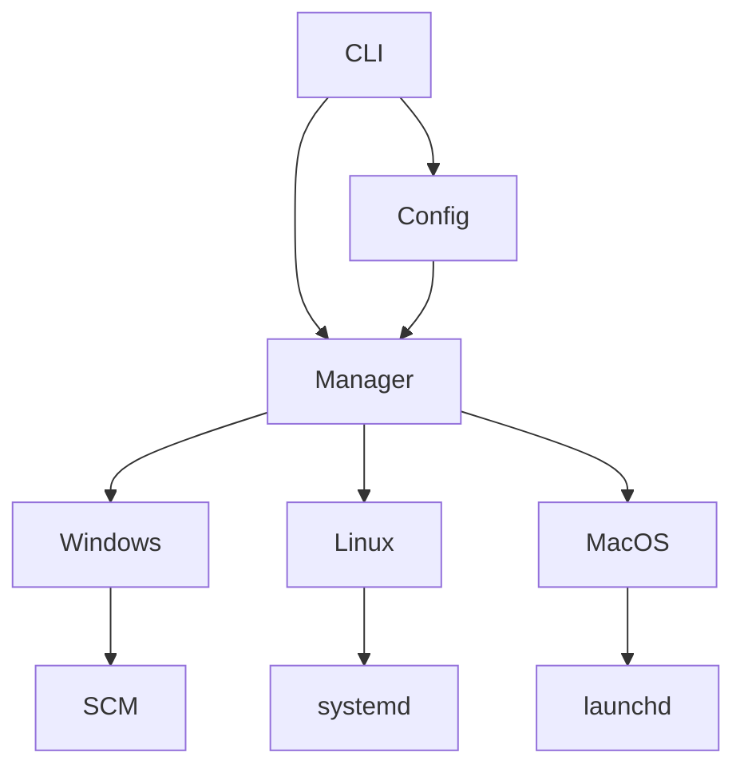

# Shawl 跨平台服務管理

目前階段：架構規劃。下一步：建立三平台編譯基線，保留 Windows 行為。

## 需求
支援 Windows SCM、Linux systemd、macOS launchd；統一 install/update/uninstall/start/stop/restart/status/logs；保留原有 Windows add/run CLI。支援 TOML、.env。不自行實作 Unix daemon 管理器。

## 現況
基準 b409acebe931c4cc2e6091f254cbaee912d0d637。src/main.rs 非 Windows 直接 panic；src/control.rs 使用 sc；src/service.rs 使用 Windows SCM 與 console；src/process_job.rs 使用 Job Object；build.rs 無條件編譯 Windows resource；Cargo.toml Windows 相依未分平台。

## 預計架構

新增共用 ServiceSpec 與 ServiceManager trait；Windows adapter 重用現有 control/service/process_job；Linux 產生 systemd unit；macOS 產生 launchd plist。平台相依使用 cfg 與 target dependencies。先確認 cli.rs、測試及 child binary 的平台耦合。

## 實作順序
1. 分離 Windows build resource、依賴、模組及測試；三平台 cargo check/test。
2. TOML schema、嚴格驗證、路徑解析、dotenv 與通用執行指令；秘密不得寫入命令列或日誌。
3. Windows adapter 與既有 CLI 相容；安裝更新具冪等性。
4. systemd adapter：明確 system/user scope、daemon-reload、enable、start、journalctl；使用原生重啟及 cgroup 停止。
5. launchd adapter：明確 system/gui scope、bootstrap/bootout/kickstart/print、日誌路徑；處理 KeepAlive 語意差異。
6. 安全更新與回滾、文件、三平台驗收。

## 驗收
三平台編譯、單元測試與原生服務整合測試；測試空格及特殊字元路徑、環境變數優先序、權限、重啟、停止與子程序清理、開機啟動、重複安裝、更新失敗回滾。無法等價映射的選項明確拒絕，不靜默忽略。避免 shell 插值；限制設定檔與服務帳號權限。保留 MIT 授權及原始歷史。未經驗證不得宣稱跨平台完成。
