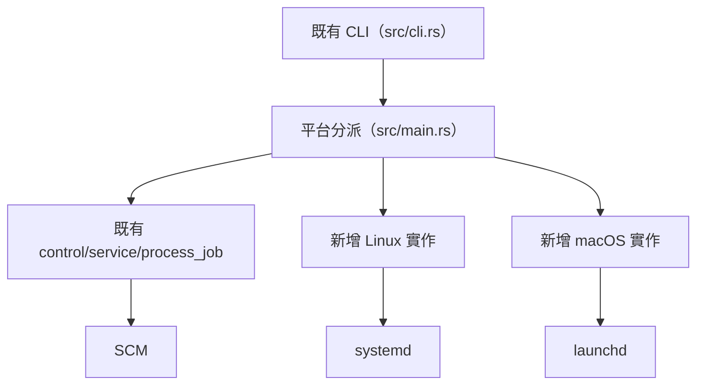

# Shawl 跨平台支援

目前階段：縮減範圍後的架構規劃。下一步：完整審查現有 CLI、程序生命週期、child binary、CI 與測試，建立三平台編譯基線。

## 目標與範圍
以最小改動擴充 Linux（systemd）及 macOS（launchd），保留 Windows SCM、Job Object、程序監控、既有 add/run CLI 與 MIT 授權。只抽離確有共用需求的邏輯，不強制新增 trait 或重寫 Windows 實作。Linux 僅承諾 systemd 環境。
TOML、原生 .env 載入、統一服務管理 CRUD CLI（install/update/uninstall/start/stop/restart/status/logs）均延後為獨立功能；本期使用平台原生管理指令。mise 不納入專屬整合。

## 現況
基準 b409acebe931c4cc2e6091f254cbaee912d0d637。src/main.rs 非 Windows 直接 panic；src/control.rs 使用 sc；src/service.rs 使用 Windows SCM 與 console；src/process_job.rs 使用 Job Object；build.rs 無條件編譯 Windows resource；Cargo.toml Windows 相依未分平台。

## 預計架構

Unix 平台優先由原生管理器監督應用程式，不自行建立 daemon。既有 run 語意及無法等價映射的選項須先審查，明確文件化或拒絕，不靜默忽略。

## 實作順序
1. 分離 Windows build resource、相依、模組、child binary 與測試；建立三平台 cargo check/test 基線，保持 Windows 行為。
2. Linux：產生安全的 systemd unit，明確 system/user scope，處理 daemon-reload、註冊、原生重啟、cgroup 停止與 journal；避免 shell 插值。
3. macOS：產生安全的 launchd plist，明確 system/gui scope，處理 bootstrap/bootout、KeepAlive 語意、停止及日誌。
4. 補齊平台相容性文件、權限檢查、安裝失敗清理及三平台驗收；不覆蓋非 Shawl 管理的服務。

## 驗收
三平台編譯及單元測試；Windows 既有整合測試無回歸；Linux/macOS 實機驗證註冊、原生啟停、開機或登入啟動（依 scope）、異常重啟、正常停止、子程序清理與日誌。測試空格及特殊字元路徑、既有環境變數參數、服務帳號權限、重複註冊及失敗清理；敏感資訊不得新增至日誌，服務設定限制存取權限。無法等價映射的功能須明確拒絕或記錄差異。未經實機驗證不得宣稱完成。

## 後續獨立功能（不屬於本期）
- feature/config-file：TOML。
- feature/env-file：原生 .env。
- feature/service-management：統一服務管理指令。
上述為候選分支，尚未建立。
